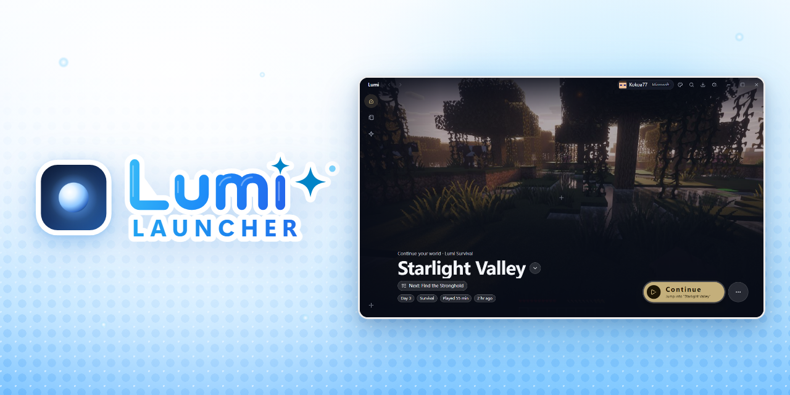
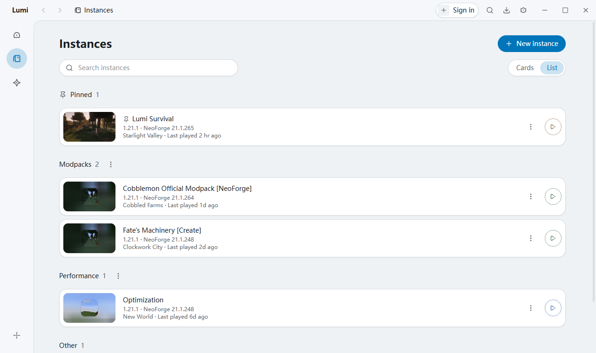
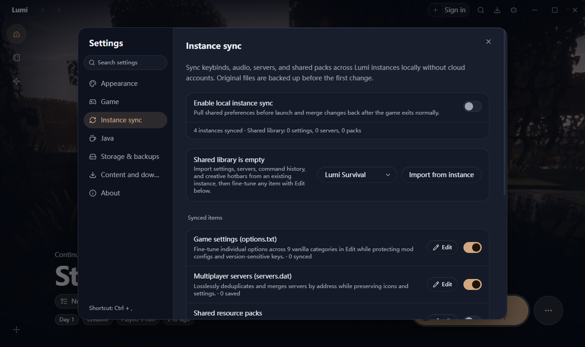

<div align="center">
  

  <h1>Lumi Launcher</h1>

  <p><strong>An independent, fast, open-source Minecraft: Java Edition launcher for Windows.</strong></p>
  <p>Open the launcher and jump straight back into your world.</p>

  <p>
    <strong>English</strong> · <a href="README.zh-CN.md">简体中文</a> · <a href="https://lumilauncher.pages.dev">Official Website</a> · <a href="https://lumilauncher.pages.dev/demo">Live Browser Demo</a>
  </p>

  <p>
    <a href="https://github.com/kokoa-77/LumiLauncher/actions/workflows/ci.yml"></a>
    <a href="LICENSE"></a>
    
    <a href="https://github.com/kokoa-77/LumiLauncher/releases"></a>
  </p>

  <p>
    <a href="https://discord.gg/vrAQ7HwUCw"></a>
    <a href="https://qm.qq.com/q/vSHOPvOKt2"></a>
    <a href="https://pd.qq.com/s/Nr15r3slq"></a>
    <a href="https://space.bilibili.com/25681030"></a>
    <a href="https://afdian.com/a/lumilauncher"></a>
  </p>
</div>

---

> **Disclaimer:** Lumi is an independent third-party launcher and is **NOT AN OFFICIAL MINECRAFT PRODUCT**. It is **NOT APPROVED BY OR ASSOCIATED WITH MOJANG STUDIOS OR MICROSOFT**. A valid, legally owned Microsoft account with Minecraft: Java Edition entitlement is required to play.

## Showcase

<table>
  <tr>
    <td width="50%">
      
      <p align="center"><sub><strong>Instance Library (Light Theme)</strong> · Isolated instances, grouping &amp; external imports</sub></p>
    </td>
    <td width="50%">
      
      <p align="center"><sub><strong>Instance Content &amp; Safety</strong> · Mod updates, version pinning &amp; change history rollback</sub></p>
    </td>
  </tr>
  <tr>
    <td width="50%">
      
      <p align="center"><sub><strong>Unified Discover</strong> · Modrinth &amp; CurseForge mods, modpacks, shaders, and worlds</sub></p>
    </td>
    <td width="50%">
      
      <p align="center"><sub><strong>Local Instance Sync</strong> · Zero-cloud sync for options, servers, packs, and hotbars</sub></p>
    </td>
  </tr>
</table>

## Highlights

- **Jump Straight Into Your World** — Full-bleed immersive home screen featuring your latest world or favorite multiplayer server, with one-click Quick Play launch and automatic world cover capture.
- **Instance-Adaptive Accent & Polished UI** — Built with Tauri 2, Rust, and React 19. Supports Windows 11 Mica backdrop, Light / Dark / System themes, reduced-motion / performance mode, and optional subtle Web Audio feedback.
- **Undo Any Mod Change** — Automatic mod-change snapshots, full content revision history with one-click rollback, `< 50ms` pre-launch mod & Java preflight checks, and automatic world backups.
- **Modrinth & CurseForge Built In** — Unified discovery and management for mods, modpacks (`.mrpack` & CurseForge), shaders, resource packs, worlds, and servers. Respects creator distribution settings: restricted CurseForge files open the official download page and claim files cleanly via SHA verification without bypassing CDN rules.
- **Zero-Cloud Local Instance Sync** — Safely synchronize up to 6 local asset categories across instances (`options.txt` with categorized visual editor & keybind capture, `servers.dat` lossless NBT merge, shared resource packs, shared shaders, command history, and saved hotbars) with automatic first-time backup and per-instance opt-outs.
- **Modern Instance Layout & External Migration** — Clean `instances/<name>/` isolation with shared vanilla assets. Link existing official / PCL / HMCL `.minecraft` directories in place or import from Prism / MultiMC, Modrinth App, CurseForge, and ATLauncher.
- **Fast, Resilient Downloads** — Multi-source download engine with hash verification, resumable `.part` downloads, optional DNS-over-HTTPS (DoH), configurable proxies (System / Direct / HTTP·SOCKS5), and optional BMCLAPI / MCIM mirrors (authentication always goes directly to official Microsoft & Mojang endpoints).
- **Power-User Tools, Kept Out of the Way** — Automatic Java detection & official runtime download, memory advisor, storage analyzer & unused version cleaner, launch hooks, custom game window titles, optional local Discord Rich Presence, and manual double-confirmed `mclo.gs` crash upload with automatic secret redaction.

## Download & Install

Download the latest version from the **[Official Website](https://lumilauncher.pages.dev/#download)** or **[GitHub Releases](https://github.com/kokoa-77/LumiLauncher/releases)**, the only official download sources.

| File | What it is |
|---|---|
| `Lumi_<version>_x64-setup.exe` | **Installer (recommended).** Installs for the current user, adds Start menu shortcuts and receives signed automatic updates. |
| `Lumi_<version>_x64-portable.zip` | **Portable.** Extract to any writable folder and run `Lumi.exe`. Settings and the default game directory are stored in the `LumiData` folder next to it. Updates are manual. |
| `SHA256SUMS.txt` | Checksums for verifying the files above. |

**Requirements:** Windows 10 or 11 (64-bit) and the Microsoft Edge WebView2 Runtime (included with Windows 11 and up-to-date Windows 10). You do not need to install Java: Lumi detects existing installations and can download the official Java runtime from Mojang.

**"Windows protected your PC":** the Windows installer is not code-signed yet, so Microsoft Defender SmartScreen may warn you the first time. Click **More info → Run anyway**. To make sure the file is genuine, verify its checksum first:

```powershell
Get-FileHash .\Lumi_0.6.2_x64-setup.exe -Algorithm SHA256
```

The output must match the line for that file in `SHA256SUMS.txt` on the same release page.

> **Beware of counterfeits.** Lumi is only published on the [Official Website](https://lumilauncher.pages.dev) and [GitHub Releases](https://github.com/kokoa-77/LumiLauncher/releases). Copies from other download sites, "cracked" or "premium" builds and anything asking for your Microsoft password are not official. See [TRADEMARK.md](TRADEMARK.md) for the list of official channels.

## Account Authentication & Release Status

- **Official Ownership Verification**: Lumi uses **OAuth 2.0 Authorization Code + PKCE** in the user's system browser via Lumi's own Microsoft Entra application registration. Before launching Minecraft, Lumi verifies current **Minecraft: Java Edition play entitlement** and the matching official Java profile through official Microsoft, Xbox Live, and Minecraft services.
- **No Bypass / No Unofficial Auth**: Lumi does not provide offline username gameplay, external skin-site authentication, authentication injectors, or unofficial capes.
- **Pre-review Build Notice**: Public builds created without an approved `LUMI_MICROSOFT_CLIENT_ID` configured keep Microsoft sign-in disabled while still allowing you to browse instances, saves, mods, and settings. Full gameplay launch becomes available once Mojang approves Lumi's AppID.

## Privacy & Security

Lumi collects **zero telemetry, zero analytics, and zero advertisements**.

- Refresh tokens are stored per account in **Windows Credential Manager** (or session memory only if the system credential store is unavailable).
- Verified Minecraft game session credentials are passed to the Java game process over its **standard input (`stdin`) pipe** (`SessionPipe.java`) rather than process command-line arguments, environment variables, or temporary argument files.
- All logs, crash reports, and exported diagnostics automatically pass through secret redaction (`<redacted>`).
- Full details: [PRIVACY.md](PRIVACY.md) · [SECURITY.md](SECURITY.md)

## FAQ

<details>
<summary><strong>Why can't I sign in yet?</strong></summary>

New launchers must be approved by Mojang before they can sign players in with a Microsoft account. Lumi's application is under review; until it is approved, public builds keep Microsoft sign-in disabled. You can still explore instances, worlds, mods and settings. Watch the releases or join the community to hear when sign-in opens.
</details>

<details>
<summary><strong>Does Lumi support offline or non-premium accounts?</strong></summary>

No. Lumi only launches the game for a Microsoft account that owns Minecraft: Java Edition. It does not provide offline usernames, third-party authentication servers or authentication injectors.
</details>

<details>
<summary><strong>Can I keep using my existing <code>.minecraft</code>, PCL or HMCL folders?</strong></summary>

Yes. You can link existing official, PCL or HMCL `.minecraft` folders in place (nothing is moved or copied), or import instances from Prism Launcher / MultiMC, Modrinth App, CurseForge and ATLauncher. Removing a linked folder only removes Lumi's record of it.
</details>

<details>
<summary><strong>My antivirus or SmartScreen flags Lumi. Is it safe?</strong></summary>

The Windows installer is not code-signed yet, which can trigger warnings from SmartScreen and some antivirus software. Download only from GitHub Releases and compare the file's SHA-256 with `SHA256SUMS.txt`. If the checksum matches, you can report the warning to your antivirus vendor as a false positive. Automatic updates are signed and verified by Lumi before they are installed.
</details>

<details>
<summary><strong>Where is my data stored?</strong></summary>

- Installer version: settings in `%APPDATA%\com.lumilauncher.lumi`, logs in `%LOCALAPPDATA%\com.lumilauncher.lumi\logs`. The default game directory is `%APPDATA%\com.lumilauncher.lumi\minecraft`, unless you chose another folder in Settings → Game directory.
- Portable version: everything is in the `LumiData` folder next to `Lumi.exe`.
- Sign-in tokens are kept in Windows Credential Manager, never in plain files.

See [ARCHITECTURE.md](ARCHITECTURE.md#data-locations) for the full list.
</details>

<details>
<summary><strong>How do I uninstall Lumi completely?</strong></summary>

1. In Lumi, remove your accounts (this also deletes their tokens from Windows Credential Manager).
2. Uninstall Lumi from **Settings → Apps → Installed apps**. Your game directory and worlds are kept.
3. To remove everything, delete `%APPDATA%\com.lumilauncher.lumi` and `%LOCALAPPDATA%\com.lumilauncher.lumi`. **Back up your worlds first** if you used the default game directory, because it lives inside the first folder.
</details>

<details>
<summary><strong>Will there be macOS or Linux versions?</strong></summary>

Lumi currently supports Windows 10 and 11 only. Other platforms may come later.
</details>

## Community & Support

| Where | Best for |
|---|---|
| [GitHub Issues](https://github.com/kokoa-77/LumiLauncher/issues/new/choose) | Bug reports, game crashes and feature requests (English or Chinese) |
| [GitHub Discussions](https://github.com/kokoa-77/LumiLauncher/discussions) | Ideas, questions and sharing your setup |
| [Discord](https://discord.gg/vrAQ7HwUCw) | Chatting with other players and the developer (separate English and Chinese channels) |
| [QQ Group](https://qm.qq.com/q/vSHOPvOKt2) · [QQ Channel](https://pd.qq.com/s/Nr15r3slq) | Chinese-speaking community, announcements and help |
| [Bilibili](https://space.bilibili.com/25681030) | Development updates and videos from the developer (Chinese) |

Please report bugs on GitHub rather than only in chat, so they are not lost. Security issues go through [private vulnerability reporting](https://github.com/kokoa-77/LumiLauncher/security/advisories/new), never in public.

## Sponsor

Every Lumi feature is free for everyone, forever. If Lumi helps you, you can support its development on [afdian](https://afdian.com/a/lumilauncher), a Chinese creator-support platform. Sponsorship is entirely voluntary and never unlocks features, early builds or faster support.

## Contributing

Bug reports, crash logs, translations and ideas are the most valuable contributions; you do not need to write code to help. If you want to contribute code, please open an issue first and wait for the maintainer to agree on the approach. Read [CONTRIBUTING.md](CONTRIBUTING.md) before you start.

## Building from Source

### Prerequisites (Windows 10/11 x64)

- [Rust](https://www.rust-lang.org/) (pinned via [`rust-toolchain.toml`](rust-toolchain.toml)) + MSVC C++ Build Tools (Windows 10/11 SDK)
- [Node.js](https://nodejs.org/) 24+ and [pnpm](https://pnpm.io/) 12+ (pinned via `packageManager` in `package.json`)
- Microsoft Edge WebView2 Runtime (pre-installed on Windows 11 and modern Windows 10)

### Commands

```powershell
# Install frontend dependencies
pnpm install --frozen-lockfile

# Run the full quality suite (cargo fmt, clippy, cargo test, Biome, TypeScript, Vitest)
pnpm check

# Start desktop app in development mode
pnpm dev

# Build production Windows installer (NSIS)
pnpm --dir app tauri build --bundles nsis
```

To build with your own approved Microsoft Entra Application Client ID:

```powershell
$env:LUMI_MICROSOFT_CLIENT_ID = "<your-client-id>"
pnpm --dir app tauri build --bundles nsis
```

See [ARCHITECTURE.md](ARCHITECTURE.md) for the codebase layout, [docs/DESIGN.md](docs/DESIGN.md) for the design and engineering rules, and [CONTRIBUTING.md](CONTRIBUTING.md) before opening a pull request.

## Release Integrity

- Official builds are produced from this repository by the [Windows release workflow](.github/workflows/windows-release.yml) on GitHub Actions, and every release includes `SHA256SUMS.txt`.
- **The Windows installer and executable are not code-signed yet.** Windows may show a SmartScreen warning; verify the checksum as described in [Download & Install](#download--install).
- **Automatic updates are signed.** The installed version only accepts update packages signed with Lumi's updater key, and verifies the signature before installing.

## Forks, Redistribution & Brand

You are free to study, fork, modify and redistribute Lumi's source code under **`GPL-3.0-only`**, including the Section 7 additional terms in [LICENSE](LICENSE). In short, a modified build must:

1. Use its **own name, application ID and icon**, not `Lumi`, `Lumi Launcher`, `微光` or `com.lumilauncher.lumi`.
2. Say clearly that it is **not official Lumi** and not endorsed by the Lumi project.
3. **Never reuse Lumi's credentials** (Microsoft Entra Client ID, updater keys, API keys).
4. Stay open source under `GPL-3.0-only` and keep the original copyright notices.

Mirroring unmodified official builds is allowed if the files are identical to the release. Full details, including the official channels and how to report counterfeits, are in **[TRADEMARK.md](TRADEMARK.md)**.

## Acknowledgments & License

- Lumi integrates with official **Mojang / Microsoft**, **[Modrinth](https://modrinth.com/)** and **[CurseForge](https://www.curseforge.com/minecraft)** services, and optionally uses the community mirrors **[BMCLAPI](https://bmclapidoc.bangbang93.com/)** (by bangbang93) and **[MCIM](https://www.mcimirror.top/)** for faster downloads in mainland China (authentication requests never use mirrors). Thanks to everyone who keeps these services running.
- Open-source libraries used by Lumi and their licenses are listed in the app under **Settings → About → Third-party libraries & licenses**.
- **Source Code**: Licensed under **GNU General Public License v3.0 only (`GPL-3.0-only`)** with Section 7 brand and name protection terms. See [LICENSE](LICENSE).
- **Brand & Original Artwork**: Copyright © 2026 `kokoa-77`. Distributed with the code under `GPL-3.0-only`; the Section 7 terms restrict how modified versions may use the Lumi names, icon and illustrations.
