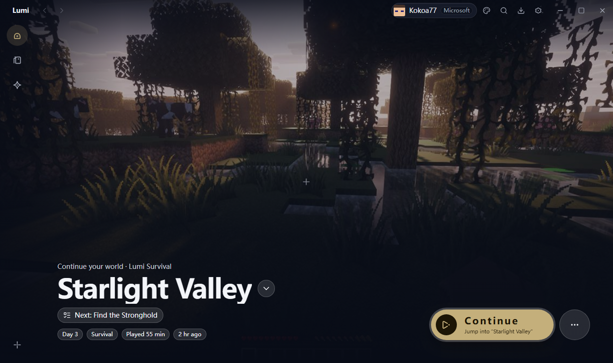
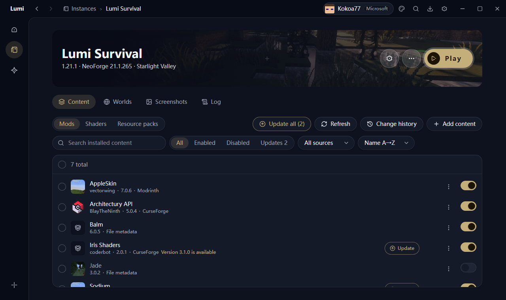
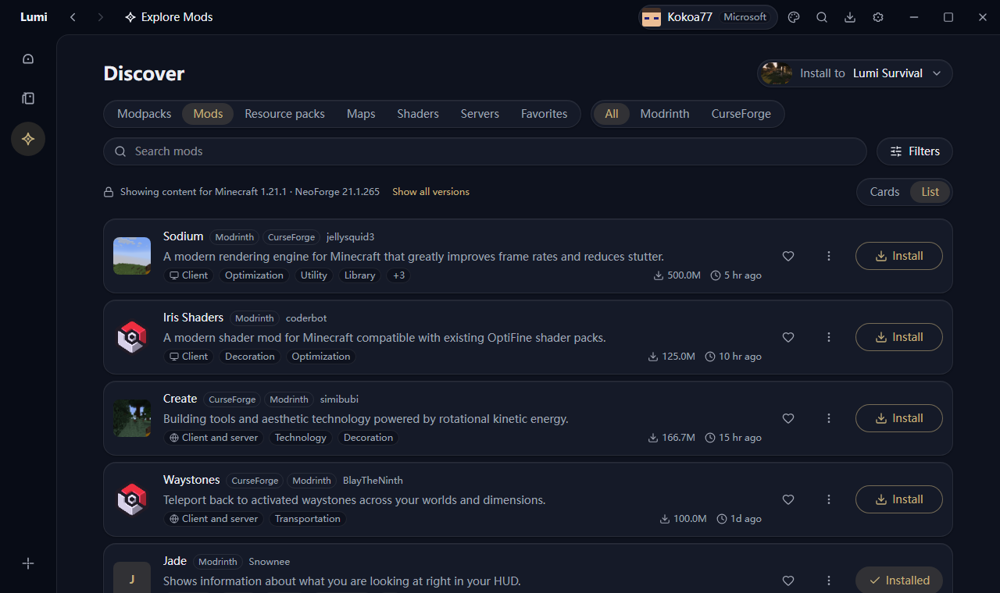

<div align="center">
  
  <h1>Lumi</h1>
  <p><strong>An independent, fast, open-source Minecraft: Java Edition launcher for Windows.</strong></p>
  <p>Open the launcher and jump straight back into your world.</p>

  <p>
    <strong>English</strong> · <a href="README.zh-CN.md">简体中文</a>
  </p>

  <p>
    <a href="https://github.com/kokoa-77/LumiLauncher/actions/workflows/ci.yml">
      
    </a>
    <a href="LICENSE">
      
    </a>
    
    <a href="https://github.com/kokoa-77/LumiLauncher/releases">
      
    </a>
  </p>
</div>

---

> **Disclaimer:** Lumi is an independent third-party launcher and is **NOT AN OFFICIAL MINECRAFT PRODUCT**. It is **NOT APPROVED BY OR ASSOCIATED WITH MOJANG STUDIOS OR MICROSOFT**. A valid, legally owned Microsoft account with Minecraft: Java Edition entitlement is required to play.

## Showcase

<p align="center">
  
</p>

<table>
  <tr>
    <td width="50%">
      
      <p align="center"><sub><strong>Instance Library (Light Theme)</strong> · Isolated instances, grouping &amp; external imports</sub></p>
    </td>
    <td width="50%">
      
      <p align="center"><sub><strong>Instance Content &amp; Safety</strong> · Mod updates, version pinning &amp; change history rollback</sub></p>
    </td>
  </tr>
  <tr>
    <td width="50%">
      
      <p align="center"><sub><strong>Unified Discover</strong> · Modrinth &amp; CurseForge mods, modpacks, shaders, and worlds</sub></p>
    </td>
    <td width="50%">
      
      <p align="center"><sub><strong>Local Instance Sync</strong> · Zero-cloud sync for options, servers, packs, and hotbars</sub></p>
    </td>
  </tr>
</table>

## Highlights

- **Jump Straight Into Your World** — Full-bleed immersive home screen featuring your latest world or favorite multiplayer server, with one-click Quick Play launch and automatic world cover capture.
- **Instance-Adaptive Accent & Polished UI** — Built with Tauri 2, Rust, and React 19. Supports Windows 11 Mica backdrop, Light / Dark / System themes, reduced-motion / performance mode, and optional subtle Web Audio feedback.
- **Never Break Your Pack** — Automatic mod-change snapshots, full content revision history with one-click rollback, `< 50ms` pre-launch mod & Java preflight checks, and automatic world backups.
- **Modrinth & CurseForge Built In** — Unified discovery and management for mods, modpacks (`.mrpack` & CurseForge), shaders, resource packs, worlds, and servers. Respects creator distribution settings: restricted CurseForge files open the official download page and claim files cleanly via SHA verification without bypassing CDN rules.
- **Zero-Cloud Local Instance Sync** — Safely synchronize up to 6 local asset categories across instances (`options.txt` with categorized visual editor & keybind capture, `servers.dat` lossless NBT merge, shared resource packs, shared shaders, command history, and saved hotbars) with automatic first-time backup and per-instance opt-outs.
- **Modern Instance Layout & External Migration** — Clean `instances/<name>/` isolation with shared vanilla assets. Link existing official / PCL / HMCL `.minecraft` directories in place or import from Prism / MultiMC, Modrinth App, CurseForge, and ATLauncher.
- **Fast, Resilient Downloads** — Multi-source download engine with hash verification, resumable `.part` downloads, optional DNS-over-HTTPS (DoH), configurable proxies (System / Direct / HTTP·SOCKS5), and optional BMCLAPI / MCIM mirrors (authentication always goes directly to official Microsoft & Mojang endpoints).
- **Power-User Tools, Kept Out of the Way** — Automatic Java detection & official runtime download, memory advisor, storage analyzer & unused version cleaner, launch hooks, custom game window titles, optional local Discord Rich Presence, and manual double-confirmed `mclo.gs` crash upload with automatic secret redaction.

## Account Authentication & Release Status

- **Official Ownership Verification**: Lumi uses **OAuth 2.0 Authorization Code + PKCE** in the user's system browser via Lumi's own Microsoft Entra application registration. Before launching Minecraft, Lumi verifies current **Minecraft: Java Edition play entitlement** and the matching official Java profile through official Microsoft, Xbox Live, and Minecraft services.
- **No Bypass / No Unofficial Auth**: Lumi does not provide offline username gameplay, external skin-site authentication, authentication injectors, or unofficial capes.
- **Pre-review Build Notice**: Public builds created without an approved `LUMI_MICROSOFT_CLIENT_ID` configured keep Microsoft sign-in disabled while still allowing you to browse instances, saves, mods, and settings. Full gameplay launch becomes available once Mojang approves Lumi's AppID.

## Privacy & Security

Lumi collects **zero telemetry, zero analytics, and zero advertisements**.

- Refresh tokens are stored per account in **Windows Credential Manager** (or session memory only if the system credential store is unavailable).
- Verified Minecraft game session credentials are passed to the Java game process over its **standard input (`stdin`) pipe** (`SessionPipe.java`) rather than process command-line arguments, environment variables, or temporary argument files.
- All logs, crash reports, and exported diagnostics automatically pass through secret redaction (`<redacted>`).
- Full details: [PRIVACY.md](PRIVACY.md) · [SECURITY.md](SECURITY.md)

## Building from Source

### Prerequisites (Windows 10/11 x64)

- [Rust](https://www.rust-lang.org/) (pinned via [`rust-toolchain.toml`](rust-toolchain.toml)) + MSVC C++ Build Tools (Windows 10/11 SDK)
- [Node.js](https://nodejs.org/) 24+ and [pnpm](https://pnpm.io/) 10+
- Microsoft Edge WebView2 Runtime (pre-installed on Windows 11 and modern Windows 10)

### Commands

```powershell
# Install frontend dependencies
pnpm install --frozen-lockfile

# Run the full quality suite (cargo fmt, clippy, cargo test, Biome, TypeScript, Vitest)
pnpm check

# Start desktop app in development mode
pnpm dev

# Build production Windows installer (NSIS)
pnpm --dir app tauri build --bundles nsis
```

To build with your own approved Microsoft Entra Application Client ID:

```powershell
$env:LUMI_MICROSOFT_CLIENT_ID = "<your-client-id>"
pnpm --dir app tauri build --bundles nsis
```

See [ARCHITECTURE.md](ARCHITECTURE.md) for the codebase layout and [CONTRIBUTING.md](CONTRIBUTING.md) before opening a pull request.

## Code Signing Policy

Once approved by [SignPath Foundation](https://signpath.org/), official Windows release binaries will use free open-source code signing provided by [SignPath.io](https://signpath.io/) with certificates from SignPath Foundation.

- **Committers & Reviewers**: Maintainers of `kokoa-77/LumiLauncher`.
- **Approvers**: Project owner (`kokoa-77`), who reviews and approves release builds before signing.
- **Privacy Policy**: See [PRIVACY.md](PRIVACY.md) and [SECURITY.md](SECURITY.md).

## Forking, Redistribution & Brand Policy

You are free to study, fork, modify, and redistribute Lumi's source code **strictly under the terms of `GPL-3.0-only`** (including its Section 7 additional terms in [LICENSE](LICENSE)). Any redistributed modified version **must remain open source under `GPL-3.0-only`**, retain original copyright notices, and clearly state what was changed.

To protect players from counterfeit builds and protect original creative work, modified builds and forks **must**:

1. **Rebrand cleanly**: Clearly state that your fork is **not** official Lumi and is not endorsed by or affiliated with `kokoa-77` or Lumi Launcher. Do not reuse the names `Lumi`, `微光`, or `Lumi Launcher`, or the app identifier `com.lumilauncher.lumi`.
2. **Replace original brand & artwork assets**: Lumi's logos, icons (`app/src-tauri/icons/`), original illustrations (`app/src/assets/art/`), promotional graphics (`docs/screenshots/social-preview.png`), and author avatar are **not** licensed for rebranded forks or third-party redistribution (**All Rights Reserved**).
3. **Never reuse official credentials or keys**: Do not ship or embed Lumi's Microsoft Entra Client ID (`LUMI_MICROSOFT_CLIENT_ID`), updater public key (`LUMI_UPDATER_PUBKEY`), or any third-party API keys. Register your own credentials or leave them unset.

## Acknowledgments & License

- Lumi integrates with official **Mojang / Microsoft**, **Modrinth**, and **CurseForge** services, and optionally supports community mirrors **BMCLAPI** and **MCIM** for faster asset delivery (authentication requests never use mirrors). Full dependency licenses and attributions are listed in [THIRD_PARTY.md](THIRD_PARTY.md).
- **Source Code**: Licensed under **GNU General Public License v3.0 only (`GPL-3.0-only`)** with Section 7 brand and name protection terms. See [LICENSE](LICENSE).
- **Brand & Original Artwork**: Copyright © 2026 `kokoa-77`. All Rights Reserved.
