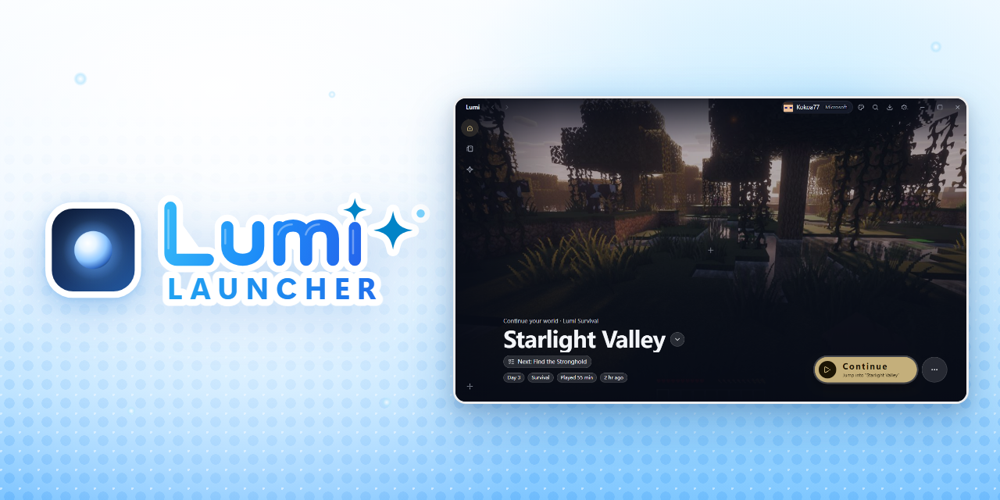
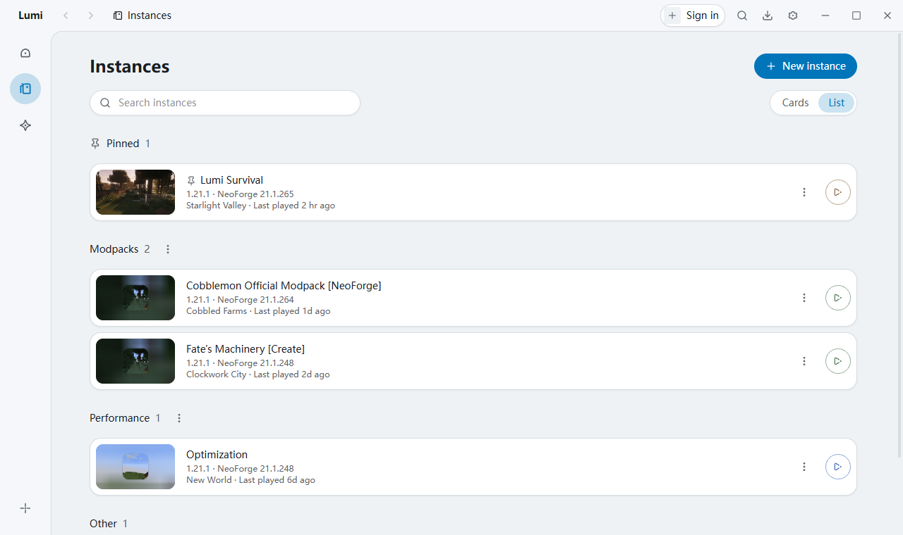
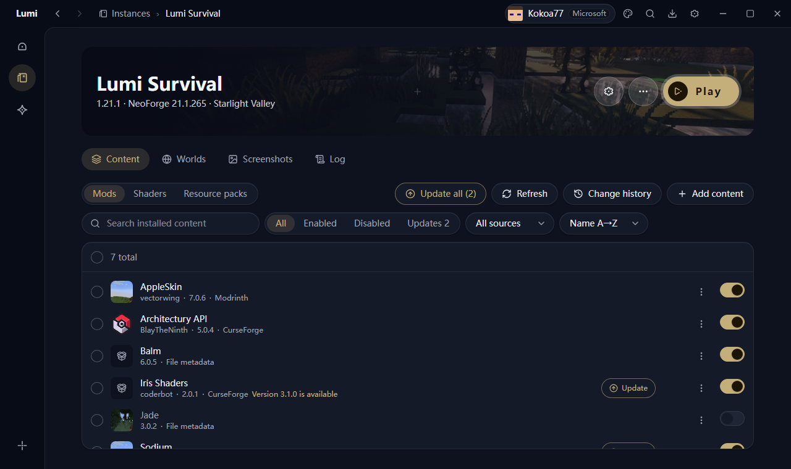
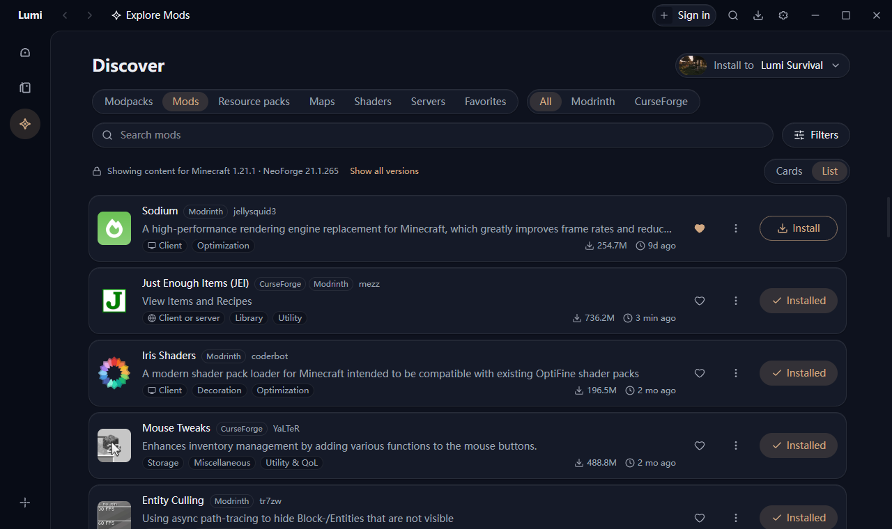

<div align="center">
  

  <h1>Lumi Launcher · 微光</h1>

  <p><strong>独立、轻快、开源的 Windows Minecraft Java 版启动器</strong></p>
  <p>点亮你的世界 · 打开就有游戏可以点</p>

  <p>
    <a href="README.md">English</a> · <strong>简体中文</strong>
  </p>

  <p>
    <a href="https://github.com/kokoa-77/LumiLauncher/actions/workflows/ci.yml"></a>
    <a href="LICENSE"></a>
    
    <a href="https://github.com/kokoa-77/LumiLauncher/releases"></a>
  </p>
</div>

---

> **独立声明**：Lumi 是独立第三方启动器，**并非 Minecraft 官方产品**，**与 Mojang Studios 及 Microsoft 无隶属关系，亦未获得其认可**。游玩需要合法拥有 Minecraft Java 版游玩权的 Microsoft 正版账户。

## 界面一览

<table>
  <tr>
    <td width="50%">
      
      <p align="center"><sub><strong>实例库（浅色主题）</strong> · 独立实例隔离、分组管理与外部启动器迁移</sub></p>
    </td>
    <td width="50%">
      
      <p align="center"><sub><strong>实例内容与永不玩坏</strong> · 模组检查更新、锁定版本与改动历史回滚</sub></p>
    </td>
  </tr>
  <tr>
    <td width="50%">
      
      <p align="center"><sub><strong>统一资源发现</strong> · 内置 Modrinth &amp; CurseForge 模组、整合包、光影与地图</sub></p>
    </td>
    <td width="50%">
      
      <p align="center"><sub><strong>本机跨实例同步</strong> · 零云端安全同步按键画面、服务器、通用包与快捷栏</sub></p>
    </td>
  </tr>
</table>

## 核心亮点

- **直达你的世界与多人服**：沉浸式全窗首页展示最近游玩的世界或常用服务器，支持自动截取游戏封面与一键 Quick Play 直连。
- **随实例变色与微光动效**：基于 Tauri 2 + Rust + React 19 打造；支持 Windows 11 云母（Mica）背景、深浅主题、低配流畅模式与可选轻柔 Web Audio 音效。
- **永不玩坏**：模组变动自动快照与改动历史一键撤销、启动前 `< 50ms` 模组/Java 硬伤预检，以及世界自动备份与恢复。
- **内置 Modrinth 与 CurseForge**：统一浏览、安装与更新模组、整合包（`.mrpack` / CurseForge）、光影、材质包、地图与服务器；尊重作者分发限制，受限 CurseForge 文件通过官方页面下载并按哈希认领，绝不绕过 CDN 规则。
- **纯本机跨实例同步**：零云端、零账号绑定，支持 6 类高频资产按需同步（`options.txt` 9 栏可视化编辑与键盘/鼠标直录、`servers.dat` 无损 NBT 去重合并、通用材质包、通用光影、命令记录与创造模式物品栏），首次开启自动备份，支持单实例细粒度排除。
- **国际主流目录与无缝迁移**：采用 `instances/<实例名>/` 隔离布局并共享游戏本体；支持原地挂接官方 / PCL / HMCL 目录，或从 Prism / MultiMC、Modrinth App、CurseForge、ATLauncher 导入实例。
- **稳定快速的下载引擎**：并发断点续传、哈希校验、可选 DoH 与网络代理（跟随系统 / 直连 / 自定义 HTTP·SOCKS5），可选 BMCLAPI / MCIM 社区加速镜像（账号认证始终直连 Microsoft / Mojang 官方接口）。
- **克制收纳的高阶能力**：自动发现并一键安装官方 Java、内存分配建议、存储空间分析与闲置版本清理、启动前后钩子、自定义游戏窗口标题、可选本机 Discord 活动状态，以及二次确认脱敏上传 `mclo.gs`。

## 账号认证与当前状态

- **官方正版游玩权核验**：通过系统浏览器执行 **OAuth 2.0 授权码 + PKCE** 登录 Lumi 自有 Microsoft Entra 应用，并在启动前经由 Microsoft / Xbox Live / Minecraft 官方服务核验 Java 版游玩权限与官方档案。
- **绝不绕过正版验证**：不提供离线用户名游玩、第三方皮肤站登录、认证注入器或非官方披风。
- **预审构建说明**：在未注入已获批的 `LUMI_MICROSOFT_CLIENT_ID` 的公开预审包中，Microsoft 登录入口默认关闭，你仍可浏览实例、存档、资源与设置；待 Mojang AppID 获准后发布正式可玩版本。

## 隐私与安全

Lumi **零遥测、零行为统计、零广告**。

- 刷新令牌按账号隔离保存在 **Windows 凭据管理器**（系统凭据库不可用时仅存于当前会话内存）。
- 核验通过的 Minecraft 游戏会话凭据经由 Java 子进程**标准输入（`stdin`）管道**交付（`SessionPipe.java`），绝不暴露在系统进程命令行、环境变量或临时参数文件中。
- 普通日志、崩溃日志与导出的诊断包均统一经过自动脱敏处理（`<redacted>`）。
- 详细说明见 [PRIVACY.md](PRIVACY.md) 与 [SECURITY.md](SECURITY.md)。

## 从源码构建

### 环境要求（Windows 10/11 x64）

- [Rust](https://www.rust-lang.org/)（版本锁定于 [`rust-toolchain.toml`](rust-toolchain.toml)）与 MSVC C++ 生成工具（Windows 10/11 SDK）
- [Node.js](https://nodejs.org/) 24+ 与 [pnpm](https://pnpm.io/) 10+
- Microsoft Edge WebView2 运行时（Windows 11 及现代 Windows 10 已内置）

### 常用命令

```powershell
# 安装前端锁定依赖
pnpm install --frozen-lockfile

# 运行全套静态与测试校验（cargo fmt / clippy / test + Biome / TypeScript / Vitest）
pnpm check

# 启动桌面开发模式
pnpm dev

# 构建 Windows 安装程序（NSIS）
pnpm --dir app tauri build --bundles nsis
```

如需使用你自己的已获批 Microsoft Entra 应用 Client ID 构建：

```powershell
$env:LUMI_MICROSOFT_CLIENT_ID = "<你的-client-id>"
pnpm --dir app tauri build --bundles nsis
```

了解代码结构请阅读 [ARCHITECTURE.md](ARCHITECTURE.md)，参与贡献请先查看 [CONTRIBUTING.md](CONTRIBUTING.md)。

## 代码签名政策（Code Signing Policy）

项目计划在通过开源审核后，采用 [SignPath.io](https://signpath.io/) 与 [SignPath Foundation](https://signpath.org/) 提供的免费开源 Windows 代码签名证书。

- **提交与审阅者（Committers & Reviewers）**：`kokoa-77/LumiLauncher` 维护团队。
- **签名审批人（Approvers）**：项目负责人（`kokoa-77`），每次正式发布前人工复核并批准构建产物。
- **隐私政策**：见 [PRIVACY.md](PRIVACY.md) 与 [SECURITY.md](SECURITY.md)。

## 二次分发、Fork 与品牌保护政策

你可以严格依照 **`GPL-3.0-only`**（含 [LICENSE](LICENSE) 中的 GPL 第 7 条附加条款）学习、Fork、修改与再分发 Lumi 的源代码。任何再分发的修改版本**必须同样以 `GPL-3.0-only` 开源**，保留原作者版权声明并明确标注改动说明，严禁闭源套壳。

为防止仿冒版本误导玩家并保护原创视觉资产，所有 Fork 与自定义构建**必须遵守**：

1. **明确去品牌化**：清楚声明你的派生版本并非 Lumi 官方项目，与 `kokoa-77` 及 Lumi 无任何隶属或背书关系；不得沿用 `Lumi`、`微光`、`Lumi Launcher` 名称或应用标识 `com.lumilauncher.lumi`。
2. **替换原创品牌与美术资产**：Lumi 的应用图标与 Logo（`app/src-tauri/icons/`）、原创插画（`app/src/assets/art/`）、品牌宣传图（`docs/screenshots/social-preview.png`）与开发者头像**保留全部权利（All Rights Reserved）**，不随代码开放用于换皮或二次分发。
3. **禁止沿用官方凭据与密钥**：不得内置或复用 Lumi 的 Microsoft Entra Client ID（`LUMI_MICROSOFT_CLIENT_ID`）、自动更新公钥（`LUMI_UPDATER_PUBKEY`）或任何第三方 API Key，请申请你自己的凭据或将其留空。

## 致谢与开源许可

- Lumi 接入 **Mojang / Microsoft**、**Modrinth** 与 **CurseForge** 官方服务，并可选接入 **BMCLAPI**、**MCIM** 社区镜像（账号认证始终直连官方，不经任何镜像）。全部第三方开源依赖与许可清单见 [THIRD_PARTY.md](THIRD_PARTY.md)。
- **源代码**：采用 **GNU General Public License v3.0 only（`GPL-3.0-only`）** 开源（附第 7 条品牌与名称保护附加条款），详见 [LICENSE](LICENSE)。
- **品牌与原创美术资产**：Copyright © 2026 `kokoa-77`，保留全部权利（All Rights Reserved）。
