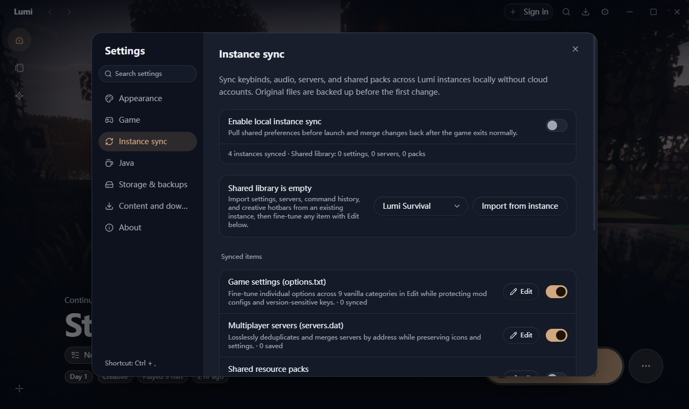

<div align="center">
  

  <h1>Lumi Launcher · 微光</h1>

  <p><strong>独立、轻快、开源的 Windows Minecraft Java 版启动器</strong></p>
  <p>点亮你的世界 · 打开就有游戏可以点</p>

  <p>
    <a href="README.md">English</a> · <strong>简体中文</strong> · <a href="https://lumilauncher.pages.dev/zh/">官方网站</a> · <a href="https://lumilauncher.pages.dev/zh/demo">浏览器在线试玩</a>
  </p>

  <p>
    <a href="https://github.com/kokoa-77/LumiLauncher/actions/workflows/ci.yml"></a>
    <a href="LICENSE"></a>
    
    <a href="https://github.com/kokoa-77/LumiLauncher/releases"></a>
  </p>

  <p>
    <a href="https://qm.qq.com/q/vSHOPvOKt2"></a>
    <a href="https://pd.qq.com/s/Nr15r3slq"></a>
    <a href="https://space.bilibili.com/25681030"></a>
    <a href="https://discord.gg/vrAQ7HwUCw"></a>
    <a href="https://afdian.com/a/lumilauncher"></a>
  </p>
</div>

---

> **独立声明**：Lumi 是独立第三方启动器，**并非 Minecraft 官方产品**，**与 Mojang Studios 及 Microsoft 无隶属关系，亦未获得其认可**。游玩需要合法拥有 Minecraft Java 版游玩权的 Microsoft 正版账户。

## 界面一览

<table>
  <tr>
    <td width="50%">
      
      <p align="center"><sub><strong>实例库（浅色主题）</strong> · 独立实例隔离、分组管理与外部启动器迁移</sub></p>
    </td>
    <td width="50%">
      
      <p align="center"><sub><strong>实例内容管理</strong> · 模组检查更新、锁定版本与改动历史回滚</sub></p>
    </td>
  </tr>
  <tr>
    <td width="50%">
      
      <p align="center"><sub><strong>统一资源发现</strong> · 内置 Modrinth &amp; CurseForge 模组、整合包、光影与地图</sub></p>
    </td>
    <td width="50%">
      
      <p align="center"><sub><strong>本机跨实例同步</strong> · 零云端安全同步按键画面、服务器、通用包与快捷栏</sub></p>
    </td>
  </tr>
</table>

## 核心亮点

- **直达你的世界与多人服**：沉浸式全窗首页展示最近游玩的世界或常用服务器，支持自动截取游戏封面与一键 Quick Play 直连。
- **随实例变色与微光动效**：基于 Tauri 2 + Rust + React 19 构建；支持 Windows 11 云母（Mica）背景、深浅主题、低配流畅模式与可选轻柔 Web Audio 音效。
- **改坏了能撤回**：模组变动自动快照与改动历史一键撤销、启动前 `< 50ms` 模组/Java 硬伤预检，以及世界自动备份与恢复。
- **内置 Modrinth 与 CurseForge**：统一浏览、安装与更新模组、整合包（`.mrpack` / CurseForge）、光影、材质包、地图与服务器；尊重作者分发限制，受限 CurseForge 文件通过官方页面下载并按哈希认领，不绕过 CDN 规则。
- **纯本机跨实例同步**：零云端、零账号绑定，支持 6 类高频资产按需同步（`options.txt` 9 栏可视化编辑与键盘/鼠标直录、`servers.dat` 无损 NBT 去重合并、通用材质包、通用光影、命令记录与创造模式物品栏），首次开启自动备份，支持单实例细粒度排除。
- **主流目录布局与迁移**：采用 `instances/<实例名>/` 隔离布局并共享游戏本体；支持在「设置 → 游戏」原地关联官方 / PCL / HMCL 目录，或在「新建实例 → 从其他启动器导入」从 Prism / MultiMC、Modrinth App、CurseForge、ATLauncher 导入实例。
- **稳定快速的下载引擎**：并发断点续传、哈希校验、可选 DoH 与网络代理（跟随系统 / 直连 / 自定义 HTTP·SOCKS5），可选 BMCLAPI / MCIM 社区加速镜像（账号认证始终直连 Microsoft / Mojang 官方接口）。
- **克制收纳的高阶能力**：自动发现并一键安装官方 Java、内存分配建议、存储空间分析与闲置版本清理、启动前后钩子、自定义游戏窗口标题、可选本机 Discord 活动状态，以及二次确认脱敏上传 `mclo.gs`。

## 下载与安装

请从 **[官方网站](https://lumilauncher.pages.dev/zh/#download)** 或 **[GitHub Releases](https://github.com/kokoa-77/LumiLauncher/releases)** 下载最新版本，这两个是仅有的官方下载渠道。

| 文件 | 说明 |
|---|---|
| `Lumi_<版本号>_x64-setup.exe` | **安装版（推荐）**。为当前用户安装，添加开始菜单快捷方式，并接收经过签名的自动更新。 |
| `Lumi_<版本号>_x64-portable.zip` | **便携版**。解压到任意可写的文件夹后运行 `Lumi.exe`；设置和默认游戏目录保存在旁边的 `LumiData` 文件夹中，需要手动更新。 |
| `SHA256SUMS.txt` | 用于核对以上文件的校验和。 |

**系统要求**：Windows 10 或 11（64 位），以及 Microsoft Edge WebView2 运行时（Windows 11 和保持更新的 Windows 10 已自带）。无需另外安装 Java：Lumi 会识别电脑上已有的 Java，也可以从 Mojang 官方下载 Java 运行时。

**提示「Windows 已保护你的电脑」**：Windows 安装包暂未进行代码签名，首次运行时 Microsoft Defender SmartScreen 可能弹出提醒，点击 **更多信息 → 仍要运行** 即可。如需确认文件未被篡改，可以先核对校验和：

```powershell
Get-FileHash .\Lumi_0.6.2_x64-setup.exe -Algorithm SHA256
```

输出的值应与同一发布页 `SHA256SUMS.txt` 中对应文件的那一行一致。

> **谨防冒名版本**：Lumi 只在[官方网站](https://lumilauncher.pages.dev/zh/)与 [GitHub Releases](https://github.com/kokoa-77/LumiLauncher/releases) 发布。其他下载站的转载、所谓「破解版」「高级版」以及任何索要 Microsoft 密码的程序都不是官方版本。官方渠道列表见 [TRADEMARK.md](TRADEMARK.md#简体中文)。

## 账号认证与当前状态

- **官方正版游玩权核验**：通过系统浏览器执行 **OAuth 2.0 授权码 + PKCE** 登录 Lumi 自有 Microsoft Entra 应用，并在启动前经由 Microsoft / Xbox Live / Minecraft 官方服务核验 Java 版游玩权限与官方档案。
- **绝不绕过正版验证**：不提供离线用户名游玩、第三方皮肤站登录、认证注入器或非官方披风。
- **预审构建说明**：在未注入已获批的 `LUMI_MICROSOFT_CLIENT_ID` 的公开预审包中，Microsoft 登录入口默认关闭，你仍可浏览实例、存档、资源与设置；待 Mojang AppID 获准后发布正式可玩版本。

## 隐私与安全

Lumi **零遥测、零行为统计、零广告**。

- 刷新令牌按账号隔离保存在 **Windows 凭据管理器**（系统凭据库不可用时仅存于当前会话内存）。
- 核验通过的 Minecraft 游戏会话凭据经由 Java 子进程**标准输入（`stdin`）管道**交付（`SessionPipe.java`），绝不暴露在系统进程命令行、环境变量或临时参数文件中。
- 普通日志、崩溃日志与导出的诊断包均统一经过自动脱敏处理（`<redacted>`）。
- 详细说明见 [PRIVACY.md](PRIVACY.md) 与 [SECURITY.md](SECURITY.md)。

## 常见问题

<details>
<summary><strong>为什么现在还不能登录？</strong></summary>

新的启动器需要通过 Mojang 审核，才能使用 Microsoft 账号为玩家登录。Lumi 的申请正在审核中，获批之前公开版本的 Microsoft 登录入口保持关闭，你仍可以浏览实例、存档、模组与设置。登录开放时会在发布页和社区群中通知。
</details>

<details>
<summary><strong>支持离线账号或非正版账号吗？</strong></summary>

不支持。Lumi 只为拥有 Minecraft Java 版的 Microsoft 账号启动游戏，不提供离线用户名、第三方认证服务器或认证注入器。
</details>

<details>
<summary><strong>能继续使用原来的 <code>.minecraft</code>、PCL 或 HMCL 的目录吗？</strong></summary>

可以。官方、PCL、HMCL 的 `.minecraft` 目录可以原地挂上（不移动、不复制任何文件），也可以从 Prism Launcher / MultiMC、Modrinth App、CurseForge、ATLauncher 导入实例。移除挂上的目录只删除 Lumi 这边的记录。
</details>

<details>
<summary><strong>杀毒软件或 SmartScreen 报毒，安全吗？</strong></summary>

Windows 安装包暂未进行代码签名，可能触发 SmartScreen 和部分杀毒软件的提醒。请只从 GitHub Releases 下载，并将文件的 SHA-256 与 `SHA256SUMS.txt` 核对；校验和一致时，可以向杀毒软件厂商报告误报。自动更新包带有签名，Lumi 会在安装前校验。
</details>

<details>
<summary><strong>我的数据保存在哪里？</strong></summary>

- 安装版：设置在 `%APPDATA%\com.lumilauncher.lumi`，日志在 `%LOCALAPPDATA%\com.lumilauncher.lumi\logs`。默认游戏目录是 `%APPDATA%\com.lumilauncher.lumi\minecraft`，在「设置 → 游戏目录」中换过的以你选择的为准。
- 便携版：全部保存在 `Lumi.exe` 旁边的 `LumiData` 文件夹。
- 登录凭据保存在 Windows 凭据管理器中，不会以明文文件保存。

完整列表见 [ARCHITECTURE.md](ARCHITECTURE.md#data-locations)。
</details>

<details>
<summary><strong>怎样彻底卸载 Lumi？</strong></summary>

1. 先在 Lumi 中移除账号（同时会从 Windows 凭据管理器中删除对应的凭据）。
2. 在 **设置 → 应用 → 安装的应用** 中卸载 Lumi。游戏目录和存档会保留。
3. 如需删除全部数据，再删除 `%APPDATA%\com.lumilauncher.lumi` 和 `%LOCALAPPDATA%\com.lumilauncher.lumi`。**使用默认游戏目录时请先备份存档**，因为它就在第一个文件夹里。
</details>

<details>
<summary><strong>会有 macOS 或 Linux 版本吗？</strong></summary>

目前只支持 Windows 10 和 11，其他平台以后再考虑。
</details>

## 社区与支持

| 渠道 | 适合做什么 |
|---|---|
| [GitHub Issues](https://github.com/kokoa-77/LumiLauncher/issues/new/choose) | 报告问题、游戏崩溃和功能建议（中文、英文都可以） |
| [GitHub Discussions](https://github.com/kokoa-77/LumiLauncher/discussions) | 交流想法、提问、分享你的配置 |
| [QQ 群](https://qm.qq.com/q/vSHOPvOKt2) · [QQ 频道](https://pd.qq.com/s/Nr15r3slq) | 中文玩家交流、版本公告与使用求助 |
| [开发者 B 站](https://space.bilibili.com/25681030) | 开发进度与视频 |
| [Discord](https://discord.gg/vrAQ7HwUCw) | 与其他玩家和开发者交流，中文、英文分区 |

遇到问题请尽量在 GitHub 上提交，只在群里反馈容易被后续消息淹没。安全漏洞请走[私密安全报告](https://github.com/kokoa-77/LumiLauncher/security/advisories/new)，不要公开发布。

## 赞助

Lumi 的所有功能对所有人永远免费。如果它帮到了你，欢迎在[爱发电](https://afdian.com/a/lumilauncher)支持开发。赞助完全自愿，不会换来额外功能、抢先版或优先处理问题。

## 参与贡献

报告问题、提供崩溃日志、翻译和提出想法都是很有价值的贡献，不会写代码也能帮上忙。如果想贡献代码，请先开 Issue 说明想法，等维护者确认方案后再动手。开始之前请阅读 [CONTRIBUTING.md](CONTRIBUTING.md)。

## 从源码构建

### 环境要求（Windows 10/11 x64）

- [Rust](https://www.rust-lang.org/)（版本锁定于 [`rust-toolchain.toml`](rust-toolchain.toml)）与 MSVC C++ 生成工具（Windows 10/11 SDK）
- [Node.js](https://nodejs.org/) 24+ 与 [pnpm](https://pnpm.io/) 12+（版本锁定在 `package.json` 的 `packageManager`）
- Microsoft Edge WebView2 运行时（Windows 11 及现代 Windows 10 已内置）

### 常用命令

```powershell
# 安装前端锁定依赖
pnpm install --frozen-lockfile

# 运行全套静态与测试校验（cargo fmt / clippy / test + Biome / TypeScript / Vitest）
pnpm check

# 启动桌面开发模式
pnpm dev

# 构建 Windows 安装程序（NSIS）
pnpm --dir app tauri build --bundles nsis
```

如需使用你自己的已获批 Microsoft Entra 应用 Client ID 构建：

```powershell
$env:LUMI_MICROSOFT_CLIENT_ID = "<你的-client-id>"
pnpm --dir app tauri build --bundles nsis
```

了解代码结构请阅读 [ARCHITECTURE.md](ARCHITECTURE.md)，设计与工程规矩见 [docs/DESIGN.md](docs/DESIGN.md)，参与贡献请先查看 [CONTRIBUTING.md](CONTRIBUTING.md)。

## 发布文件的可信性

- 官方版本由本仓库的 [Windows 发布工作流](.github/workflows/windows-release.yml) 在 GitHub Actions 上构建，每个版本都附带 `SHA256SUMS.txt`。
- **Windows 安装包和程序暂未进行代码签名**，可能出现 SmartScreen 提醒，请按[下载与安装](#下载与安装)中的方法核对校验和。
- **自动更新带有签名**：已安装的 Lumi 只接受用 Lumi 更新密钥签名的更新包，并在安装前校验签名。

## Fork、转载与品牌

你可以依照 **`GPL-3.0-only`**（含 [LICENSE](LICENSE) 中的第 7 条附加条款）学习、Fork、修改和再分发 Lumi 的源代码。简单来说，修改版必须：

1. 使用**自己的名称、应用 ID 和图标**，不得使用 `Lumi`、`Lumi Launcher`、`微光` 或 `com.lumilauncher.lumi`。
2. 明确说明**不是官方 Lumi**，也未获得 Lumi 项目认可。
3. **绝不沿用 Lumi 的凭据**（Microsoft Entra Client ID、更新密钥、各类 API Key）。
4. 以 `GPL-3.0-only` 继续开源，并保留原有的版权声明。

转载未经修改的官方版本时，文件须与发布页完全一致。完整规则、官方渠道列表和举报冒名版本的方式见 **[TRADEMARK.md](TRADEMARK.md#简体中文)**。

## 致谢与开源许可

- Lumi 接入 **Mojang / Microsoft**、**[Modrinth](https://modrinth.com/)** 与 **[CurseForge](https://www.curseforge.com/minecraft)** 官方服务，并可选使用 **[BMCLAPI](https://bmclapidoc.bangbang93.com/)**（bangbang93 维护）和 **[MCIM](https://www.mcimirror.top/)** 社区镜像加速国内下载（账号认证始终直连官方，不经任何镜像）。感谢维护这些服务的每一个人。
- Lumi 使用的开源库及其许可，可在应用的 **设置 → 关于 → 第三方开源组件与许可** 中查看。
- **源代码**：采用 **GNU General Public License v3.0 only（`GPL-3.0-only`）** 开源（附第 7 条品牌与名称保护附加条款），详见 [LICENSE](LICENSE)。
- **品牌与原创美术资产**：Copyright © 2026 `kokoa-77`，随代码以 `GPL-3.0-only` 发布；修改版如何使用 Lumi 名称、图标与插画受第 7 条附加条款限制。
